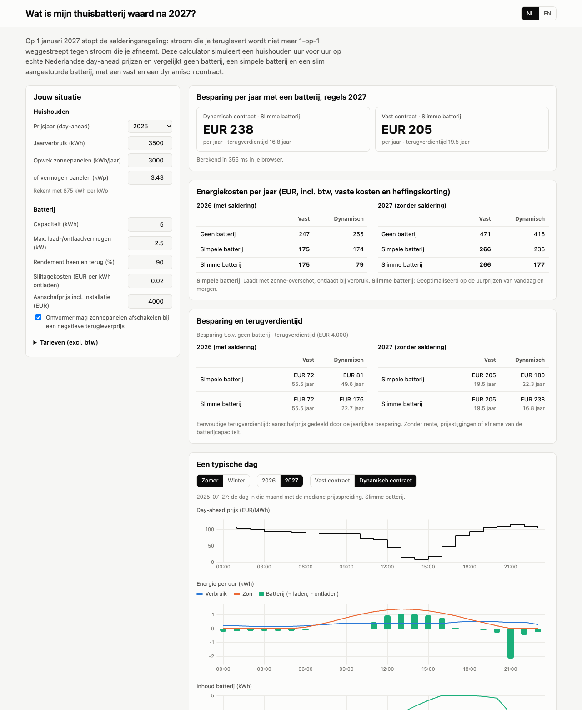

# What is my home battery worth after 2027?

On 1 January 2027 the Dutch net-metering scheme (*salderingsregeling*) ends.
Until then, a household with solar panels can net the electricity it feeds
into the grid 1:1 against what it takes from the grid over the year. From 2027
consumption and feed-in are settled separately: you pay the full price
(including energy tax and VAT) for every kWh you take, and you get a much
lower feed-in compensation, often minus feed-in costs, for every kWh you
return.

That makes self-consumption worth a lot more, and is why many households are
asking whether a home battery, a dynamic (hourly-price) contract, or both,
pay off. This tool answers that with a transparent hour-by-hour simulation on
real Dutch day-ahead prices from the
[ENTSO-E Transparency Platform](https://transparency.entsoe.eu).

**Live site:** https://tejan4422.github.io/nl-battery-2027/



## What it does

For one household and twelve months of hourly prices (by default the most
recent 12 complete months, currently 1 October 2025 to 30 September 2026) it
computes the annual electricity cost for:

| | 2026 rules (net metering) | 2027 rules (no net metering) |
|---|---|---|
| fixed contract | no battery / simple battery / smart battery | same |
| dynamic contract | no battery / simple battery / smart battery | same |

- **Simple battery:** charges from solar surplus, discharges when the house
  consumes. Does not look at prices.
- **Smart battery:** schedule optimised on the hourly prices of today and
  tomorrow (day-ahead prices are published around 13:00 the day before).

It then shows key takeaways in plain language, what the end of net metering
costs if nothing changes and what the best 2027 option wins back, the annual
saving, a simple payback time and the break-even battery price over a chosen
lifetime, a typical summer and winter day, and the saving per month. Everything
runs in the browser; there is no backend.

## Repository layout

```
config/tariffs_nl.yaml   every tariff number, with source and date
pipeline/                price data ingest, validation, JSON export, profiles
model/                   Python reference model and MILP optimiser
fixtures/                shared test cases (inputs + expected results)
tests/                   pytest suite
web/                     Vite + TypeScript site, including the DP optimiser
rl/                      placeholder for phase 2 (reinforcement learning)
```

## Running it

Requirements: [uv](https://docs.astral.sh/uv/) (installs Python 3.12 for you)
and Node.js 20 or newer.

### 1. Price data

Day-ahead prices come from the **ENTSO-E Transparency Platform** (bidding zone
BZN|NL). Raw files are not committed; the processed hourly series used by the
site is in `web/public/data/`.

**ENTSO-E CSV export (default).** On <https://transparency.entsoe.eu> open
*Market > Energy Prices*, select bidding zone *BZN|NL*, a year, and export
as CSV. Save one file per year as
`data/raw/entsoe_nl_dayahead_prices_<year>.csv`. The export uses local time
(CET/CEST), labels the DST changes, and has 15-minute rows: before
1 October 2025 the market cleared hourly and each hourly price is repeated four
times.

**ENTSO-E API (optional).** For scripted downloads:

1. Register at <https://transparency.entsoe.eu>.
2. Email transparency@entsoe.eu with the subject "Restful API access" and the
   email address of your account in the body.
3. Once access is granted, generate a security token under *My Account
   Settings*.
4. `cp .env.example .env` and put the token in `ENTSOE_API_KEY`. `.env` is in
   `.gitignore`; never commit the token.
5. `uv sync --extra entsoe`, then use `--source entsoe-api` below.

**Ember (optional).** Ember's hourly European wholesale price CSV
(<https://ember-energy.org/data/european-wholesale-electricity-price-data>),
saved as `data/raw/ember_nl_hourly.csv`, is used for 2024. For the period where
both are available, Ember's hourly values match the ENTSO-E hourly averages to
within 0.005 EUR/MWh.

### 2. Pipeline

```bash
uv sync
uv run python -m pipeline.export                            # last 12 complete months, site default
uv run python -m pipeline.export --window 2025              # a calendar year
uv run python -m pipeline.export --start 2025-04-01 --end 2026-03-31
uv run python -m pipeline.export --source ember --window 2024
uv run python -m pipeline.export_tariffs                    # YAML -> web/public/data/tariffs.json
```

For each window the export:

- combines the yearly CSVs into one series and keeps the quarter-hour data in
  `data/processed/prices_nl_15min.csv`, plus hourly averages in
  `prices_nl_hourly.csv` (both not committed)
- resolves DST from the (CET)/(CEST) labels, with row order as a fallback for
  the repeated October hour
- averages to hourly, cuts out the window in local time, checks for
  duplicates, gaps and implausible values, and prints a report
- writes `prices_nl_<window>.json` and the matching
  `profiles_nl_<window>.json`, and adds the window to `index.json`, which the
  site's price-period menu reads

```
window 2025-10-01_2026-09-30: 8760 hours
  price EUR/MWh: mean 103.03, min -498.44, max 799.36, p05 0.00, p95 192.59
  negative-price hours: 436 (5.0%)
  DST days: 23h ['2026-03-29'], 25h ['2025-10-26']
```

Empty and `n/e` prices are treated as missing. Gaps of up to 3 hours are
interpolated and listed as a warning; longer gaps stop the pipeline.
Negative prices are valid and kept. The simulation itself is hourly; the
quarter-hour series is stored so a 15-minute simulation can be added later.

### 3. Tests

```bash
uv run pytest                     # Python: pipeline, tariffs, model, MILP
cd web && npm ci && npm test      # TypeScript: tariffs, invariants, DP vs MILP
```

To regenerate the shared fixtures after an intended model change:
`uv run python -m model.fixtures --full` (about a minute).

### 4. Site

```bash
cd web
npm run dev        # http://localhost:5173
npm run build      # static files in web/dist
```

GitHub Actions runs both test suites on every push (`.github/workflows/ci.yml`)
and deploys `web/dist` to GitHub Pages on every push to `main`
(`.github/workflows/pages.yml`; enable Pages with source "GitHub Actions" in
the repository settings).

## Methodology

### Household

Hourly consumption and solar production are a normalised profile times the
annual totals entered by the user.

- **Consumption:** a synthetic residential profile (weekday and weekend daily
  shape, monthly level higher in winter, extra lighting load on dark evenings).
  It resembles the NEDU E1A profile but is not the official one. An official
  profile can be loaded with `pipeline.profiles --load-profile file.csv`.
- **Solar:** sun elevation at De Bilt for every hour, scaled per month to a
  typical Dutch yield distribution for south-facing panels (875 kWh/kWp per
  year when sizing by kWp). This is a clear-sky shape: every day in a month
  looks the same.

Energy balance in every hour:
`load + charge + export = (solar - curtailed) + discharge + import`.
The battery has a capacity, a power limit for charging and discharging (AC
side) and a round-trip efficiency, split evenly between charging and
discharging. An optional wear cost is charged per kWh discharged. Optionally
(on by default) the inverter curtails the panels in hours where feeding in has
a negative value, as many dynamic-contract setups do.

### Tariffs

All numbers are in `config/tariffs_nl.yaml`, each with `source`, `as_of` and a
`verified` flag. Amounts are stored excluding VAT.

- **Fixed contract:** consumption at supply price + energy tax, plus VAT.
  Feed-in earns a feed-in compensation (no VAT) and costs feed-in costs (plus
  VAT) per kWh.
- **Dynamic contract:** consumption at (day-ahead price + markup) plus VAT,
  plus energy tax. Feed-in earns the day-ahead price minus a fee.
- **2026 rules:** total import and export are netted over the year for the
  energy tax and, on a fixed contract, the supply price. Only a surplus earns
  the feed-in compensation. Feed-in costs apply to all feed-in.
- **2027 rules:** no netting. The 2027 energy tax applies; supplier tariffs are
  assumed unchanged.
- Standing charges, the grid operator fee and the energy tax reduction are the
  same in every scenario. They are included in the totals but do not affect
  savings.

Under netting the bill is piecewise linear in total import and export, with a
kink at import = export. The optimiser uses hourly marginal prices that assume
the household stays a net consumer. If the result is a net exporter, it is
re-run with exporter prices. If neither run is consistent with its own
assumption, the cheaper of the two is reported. The bill shown is always
recomputed exactly from the hourly flows.

### Optimiser

Per day, the battery schedule minimises
`sum(buy * import - sell * export + wear * discharge)` over a 48-hour window
(today plus tomorrow), and only today's part is kept (rolling horizon). Energy
left in the battery at the end of the window is valued halfway between the
cheapest buy-back price and the sell value, after losses and wear. Without
that terminal value the optimiser keeps the battery too empty near the end of
the window, and lost to the simple rule on a fixed contract.

- **Browser (`web/src/model/dp.ts`):** dynamic programming over the state of
  charge on a 0.1 kWh grid with linear interpolation. Candidate actions are the
  grid moves allowed by the power limit, plus "zero grid flow" moves: charge
  exactly the surplus or discharge exactly the deficit. The hourly cost is
  piecewise linear with its kinks at those points, so the DP is not limited to
  absorbing surplus in 0.1 kWh blocks.
- **Python reference (`model/lp_optimiser.py`):** the same problem as a
  mixed-integer linear programme (scipy / HiGHS). The binaries forbid charging
  and discharging, or importing and exporting, in the same hour. Without them,
  the LP relaxation "burns" energy through conversion losses at negative
  prices, which a real battery cannot do.

### Validation

The two implementations share their inputs through JSON fixtures in
`fixtures/`. For each fixture the TypeScript suite must reproduce the Python
baselines (no battery, simple battery) to 1e-6 EUR and get within 1% of the
MILP's annual energy cost with the DP.

Results on prices from 1 October 2025 to 30 September 2026, 3,500 kWh
consumption, 3,000 kWh solar, curtailment on, wear cost 0.02 EUR/kWh (annual
totals in EUR incl. fixed charges):

| battery | contract | rules | no battery | MILP | DP | DP - MILP | % of energy cost | DP time |
|---|---|---|---|---|---|---|---|---|
| 5 kWh / 2.5 kW | fixed | 2026 | 247.10 | 175.05 | 175.05 | 0.00 | 0.00% | 68 ms |
| 5 kWh / 2.5 kW | fixed | 2027 | 470.53 | 265.67 | 265.67 | 0.00 | 0.00% | 68 ms |
| 5 kWh / 2.5 kW | dynamic | 2026 | 249.52 | 42.83 | 43.00 | 0.17 | 0.05% | 67 ms |
| 5 kWh / 2.5 kW | dynamic | 2027 | 419.64 | 147.89 | 148.45 | 0.57 | 0.11% | 68 ms |
| 10 kWh / 5 kW | fixed | 2026 | 247.10 | 174.61 | 174.61 | 0.00 | 0.00% | 214 ms |
| 10 kWh / 5 kW | fixed | 2027 | 470.53 | 264.43 | 264.43 | 0.00 | 0.00% | 215 ms |
| 10 kWh / 5 kW | dynamic | 2026 | 249.52 | -113.12 | -112.92 | 0.20 | 0.06% | 215 ms |
| 10 kWh / 5 kW | dynamic | 2027 | 419.64 | 84.65 | 84.95 | 0.30 | 0.06% | 209 ms |

The DP is never better than the MILP, as expected for a discretised method,
and the largest gap is 0.2% of the battery's saving. The full set of 12
scenarios runs in about 0.4 s in the browser.

Other checks, in both languages where it applies:

- tariff formulas against hand-computed cases, and marginal prices against
  finite differences of the annual bill
- 23- and 25-hour days, 15-minute input, negative prices, gaps, duplicates
- ENTSO-E exports: DST labels (and their absence), `n/e` rows, overlapping
  files that must agree, choosing the last 12 complete months
- energy balance every hour, state of charge within bounds, power limits, no
  simultaneous charge/discharge
- the optimiser is never worse than no battery or the simple rule
- the MILP against an exact grid search, the DP against exhaustive search over
  all state-of-charge paths
- a full year of DP in under 1 second

Two problems these tests found during development are worth mentioning: the
end-of-window effect described above, and a mismatch where the MILP was
allowed to curtail solar to import more at negative prices, which the
simulation did not reproduce. Both are fixed.

## Limitations

- The solar profile has no clouds, so day-to-day variation, and the
  correlation between sunny hours and low prices, is not captured.
- The consumption profile is synthetic and the same every year.
- The smart battery has perfect foresight of prices, consumption and solar
  for today and tomorrow. Real controllers will do somewhat worse.
- Historical prices (by default the last 12 complete months) stand in for 2026 and 2027. Future prices
  will differ, and more batteries on the grid will reduce price spreads.
- The 2026 dynamic-contract result depends on whether feed-in is credited
  including VAT under net metering (`feed_in_vat_while_netting`). This is
  unverified and makes a large difference.
- No battery capacity fade, no financing costs, no grid-connection limits.
- Heat pumps and electric vehicles are not modelled (see roadmap).

## TODO: values to verify

The following entries in `config/tariffs_nl.yaml` are marked `verified: false`.
Check them against the Belastingdienst, the ACM and supplier websites, then set
`verified: true`:

- [ ] `vat`: 21%
- [ ] `energy_tax.2026`: 0.09161 EUR/kWh (0.11085 incl. VAT)
- [ ] `energy_tax.2027`: 0.08800 EUR/kWh (Belastingplan 2027, corrected table; not final)
- [ ] `tax_reduction.2026`: 519.80 EUR/year (628.96 incl. VAT)
- [ ] `tax_reduction.2027`: 519.58 EUR/year; sources disagree (628.69 vs 629.69 incl. VAT)
- [ ] `grid_fee`: 380 EUR/year, placeholder, differs per grid operator
- [ ] `fixed_contract.supply_price`: 0.130 EUR/kWh, placeholder
- [ ] `fixed_contract.feed_in_compensation`: 0.124 EUR/kWh, placeholder
- [ ] `fixed_contract.feed_in_cost`: 0.100 EUR/kWh, placeholder; some suppliers use tiered monthly fees
- [ ] `fixed_contract.standing_charge`: 72 EUR/year, placeholder
- [ ] `dynamic_contract.markup`: 0.020 EUR/kWh, placeholder
- [ ] `dynamic_contract.feed_in_fee`: 0.015 EUR/kWh, placeholder
- [ ] `dynamic_contract.feed_in_vat_while_netting`: true, check supplier terms
- [ ] `dynamic_contract.standing_charge`: 60 EUR/year, placeholder

Other open items:

- [ ] Replace the synthetic consumption profile with the official NEDU E1A profile if its licence allows redistribution
- [ ] Solar profile from KNMI irradiance data instead of clear sky

## Roadmap

- **Phase 2: reinforcement learning for heat pump and EV.** An agent that
  controls heat pump, EV charging and battery together, with comfort
  constraints and forecast uncertainty. See [`rl/README.md`](rl/README.md).
- **Multiple homes and grid congestion.** Coordinating batteries and flexible
  loads behind one transformer.
- KNMI weather data, multi-year runs, and a sensitivity view for the main
  assumptions.

## Data sources and licence

- Day-ahead prices: [ENTSO-E Transparency Platform](https://transparency.entsoe.eu),
  bidding zone BZN|NL, used under the ENTSO-E terms and conditions. The
  processed hourly series in `web/public/data/` is derived from it.
- 2024 prices: [Ember](https://ember-energy.org/data/european-wholesale-electricity-price-data),
  European Wholesale Electricity Price Data, licensed under
  [CC BY 4.0](https://creativecommons.org/licenses/by/4.0/).
- Tariff values: sources are listed per value in `config/tariffs_nl.yaml`.

Code: [MIT licence](LICENSE).

This is an estimate, not financial advice.
